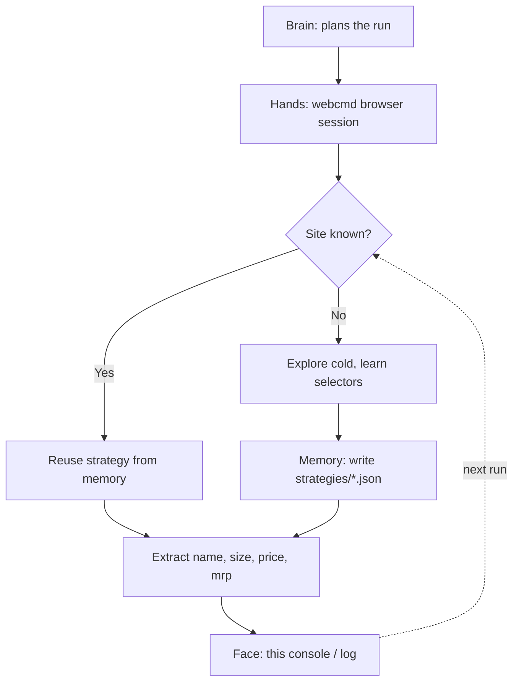

# Basket Buddy

Basket Buddy is a browser agent that compares grocery prices across quick-commerce sites. It learns how to search each platform once, saves what it learned, and reuses that on the next platform. I built it solo for the SLAB Hackathon (Self Learning Agent Browser), Track 05, Self-Learning Loops. Every browser action goes through [WebCMD](https://github.com/agentrhq/webcmd).

My fork of WebCMD: https://github.com/victorisaacchinta-eng/webcmd

## What happened on each platform

Blinkit took 6 attempts from a cold start. By the time I got to District, a site it had never touched, it worked on the first try, live on stage.

| Platform | Attempts | Outcome |
|---|---|---|
| Blinkit | 6 | cold start, no strategy existed yet |
| BigBasket | 2 | blocked (real 404, likely bot-detection), abandoned |
| Amazon | 1 | reused "verify the direct search URL before touching the DOM" |
| Zepto | 2 | URL worked first try, one fix for discount-badge noise |
| District | 1 | transfer test, no prior exposure, live |

The first four runs are logged with notes in [`learning_log.json`](./learning_log.json). Attempt counts are literal iteration counts, not estimates, and the log and `strategies/` are a direct record of what happened during the build.

On Blinkit it had to discover from scratch that the homepage search box is a fake link, not a real input, then find the real `/s/?q=` search URL and reach product cards by walking up from their ADD buttons. Amazon and Zepto both reused the "go straight to the search URL" lesson. BigBasket returned a real 404 twice, probably bot-detection on the automated Chromium, so I swapped to Amazon instead of spending hackathon time fighting it.

## How it uses WebCMD

- Every navigate, click, type and extract call is `webcmd browser run`, scoped to a `--profile`/`--session` pair per platform (`blinkit`, `amazon`, `zepto`, `bigbasket`, `district`). No raw Playwright or Selenium script drives anything.
- WebCMD's own explore-once-reuse sitemap memory is what makes later runs on a platform faster than the first. That is what the attempt counts above are measuring.
- On top of that I keep a strategy file per platform in `strategies/*.json`, written after each run: the real search URL pattern, selector notes and gotchas. That is task-level memory (what worked, what didn't), separate from WebCMD's site-structure memory.
- Each platform gets its own throwaway profile and explicit session, created and closed the way WebCMD expects. Nothing is shared across platforms.



## Guardrails

- Every run stops at read-only extraction. No checkout, no payment, no real account action.
- Human confirmation is required before anything irreversible, per the event's rules.
- A blocked platform (BigBasket) was logged and abandoned, not retried forever or worked around.
- Throwaway profiles only. No cookies or credentials are committed to this repo.

## Running it

```bash
npm install -g @agentrhq/webcmd
webcmd doctor              # must be green
webcmd skills add          # choose your coding agent when prompted

webcmd profile create <platform>
webcmd --profile <platform> session create <platform>-main -f json
# log in manually in the Chrome window that opens, if the platform needs it

webcmd --profile <platform> --session <session-id> browser run --file <platform>_search.js
```

Each `<platform>_search.js` is a self-contained extraction script, and `strategies/` explains what was learned per platform and why. The stack is just WebCMD and plain Node scripts run through `webcmd browser run`, with no other browser automation library.

There is also a multi-product benchmark: 5 products (milk, rice, shampoo, charger, notebook) on Amazon, Blinkit and Zepto. The scripts are in `benchmark_scripts/`, raw results in `benchmark_results/`, and the combined output in `benchmark.json`, which `basket-buddy-app-neobrutalist.html` loads to show the comparison.

## Hackathon checklist

- [x] Built entirely on WebCMD, every browser action goes through a `webcmd` session
- [x] Forked and starred agentrhq/webcmd: https://github.com/victorisaacchinta-eng/webcmd
- [x] Public repo with README, architecture, APIs declared, and a section on how WebCMD is used
- [x] Action logs from full runs (`learning_log.json`, `strategies/*.json`)
- [ ] 2-3 min backup demo video
- [x] One-page write-up (`basket-buddy-writeup.pdf`)
- [x] Task family with 5+ variants attempted (4 succeeded, 1 documented block)
- [x] Transfer test on an unseen variant (District)
- [x] Safe adaptation: guardrails enforced in code, not just described
- [x] No cookies, profile data, or credentials committed

## Scaling past the demo

The demo shows the agent works. It doesn't show it scales, and those are different problems.

Scraping live on every click doesn't scale, and it raises the chance of BigBasket-style blocks on every platform, not just one. A real product needs a persistent cache refreshed on a schedule, not per visitor. There is a prototype of that in [`server/`](./server): an Express server (`server.js`) serves cached results from `/api/data`, and a background job (`refresh_cache.js`) is the only place webcmd runs. `public/app.html` is the same UI pointed at this local API instead of a static file.

```bash
cd server && npm install
npm start          # serves the cache on http://localhost:3001
npm run refresh    # runs the webcmd refresh job once
```

Still open, and not something more code fixes:

- Per-location pricing. Dark-store prices vary by pincode.
- Login handling. A real product would run guest or location-only and never ask a visitor for their Blinkit password.
- The terms-of-service question that scraping at any real scale raises.

These decide whether this could ship as a standalone consumer app or only as infrastructure licensed to one platform.

## Author

Victor Isaac, ACE Engineering College, Hyderabad. Built solo.
