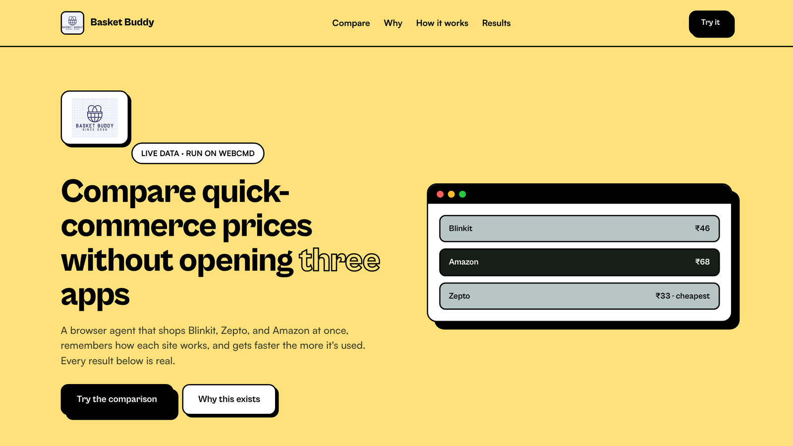
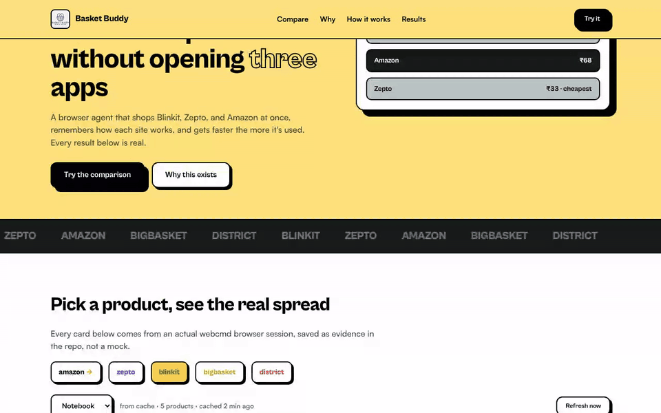
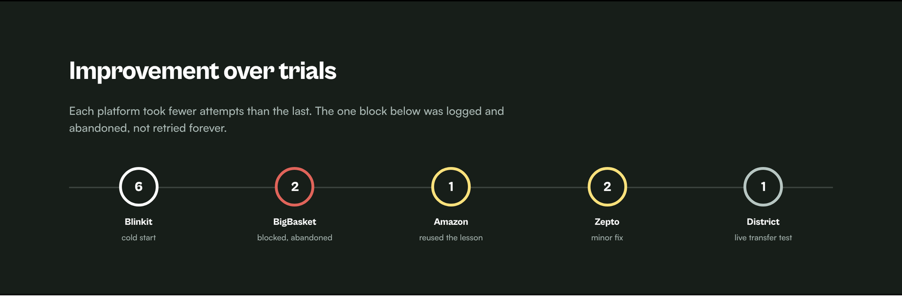
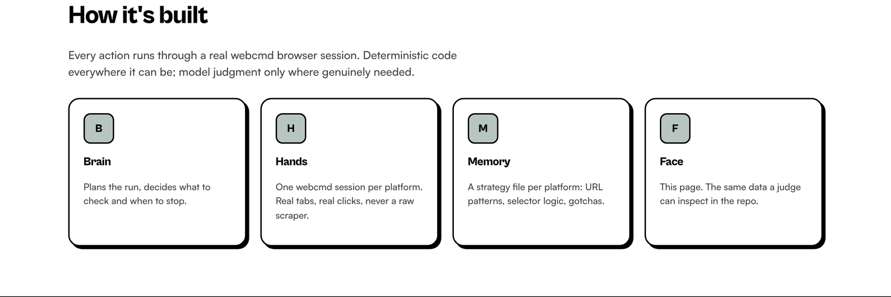
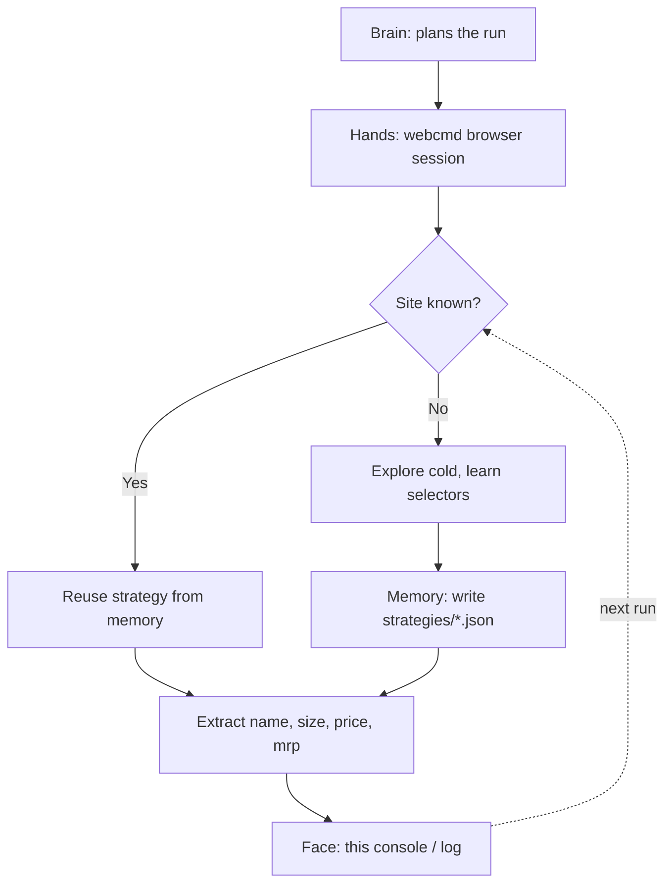

<p align="center">
  
</p>

<h1 align="center">Basket Buddy</h1>

<p align="center">
  <a href="https://github.com/agentrhq/webcmd"></a>
  
  
  
  <a href="./basket-buddy-writeup.pdf"></a>
</p>

<p align="center"><b>A browser agent that learns a platform once and reuses the lesson, proven across four real quick-commerce sites, including one it had never touched before going live.</b></p>

<p align="center">
  <a href="#see-it-work">See it work</a> ·
  <a href="#the-30-second-version">The learning curve</a> ·
  <a href="#how-we-use-webcmd">How we use WebCMD</a> ·
  <a href="#quick-start">Quick start</a> ·
  <a href="./basket-buddy-writeup.pdf">One-page write-up</a>
</p>

---

Built solo for **SLAB Hackathon** (Self Learning Agent Browser), Track 05, Self-Learning Loops. Built entirely on [WebCMD](https://github.com/agentrhq/webcmd).

Fork of WebCMD: https://github.com/victorisaacchinta-eng/webcmd

## See it work

Pick a product and Basket Buddy lines up what Blinkit, Zepto and Amazon actually returned for it, then marks the cheapest. Every card comes from a recorded WebCMD browser session saved in this repo (`server/cache.json`, `benchmark_results/`), not a mock.

<p align="center">
  
</p>

## The 30-second version

Every platform this agent touches gets harder to fool the second time. Blinkit took 6 real attempts to crack, cold. By the time it reached District, a site it had zero prior exposure to, it worked first try, live, on stage.

<p align="center">
  
</p>

| Platform | Attempts | Outcome |
|---|---|---|
| Blinkit | 6 | cold start, no strategy existed yet |
| BigBasket | 2 | blocked (real 404, likely bot-detection), correctly abandoned |
| Amazon | 1 | reused "verify the direct search URL before touching the DOM" |
| Zepto | 2 | URL worked first try, one fix for discount-badge noise |
| **District** | **1** | **transfer test, zero prior exposure, live** |

Full detail: [`learning_log.json`](./learning_log.json). After the learning runs, the same three working strategies were run across five products (milk, rice, shampoo, notebook, charger), 15 runs in all, recorded in [`benchmark_results/`](./benchmark_results) and [`benchmark.json`](./benchmark.json).

## How we use WebCMD

Every browser action in this project runs through a WebCMD session, no raw Playwright or Selenium script drives anything directly.

- **Live browser control**: every navigate, click, type, and extract call is `webcmd browser run`, scoped to a `--profile`/`--session` pair per platform (`blinkit`, `amazon`, `zepto`, `bigbasket`, `district`). Nothing bypasses WebCMD.
- **Sitemap memory**: WebCMD's own explore-once-reuse layer is what makes the second and later runs on a platform faster than the first, that's the mechanic the whole attempt-count table above is measuring.
- **Our layer on top**: a strategy store (`strategies/*.json`), one file per platform, written after each run with what was learned, e.g. the real search URL pattern, selector notes, and gotchas. This is task-level memory (what worked, what didn't), separate from and built on top of WebCMD's own site-structure memory.
- **Profiles and sessions**: each platform gets its own throwaway profile and explicit session, created and closed per WebCMD's own model, nothing shared across platforms.

<details>
<summary><b>What a learned strategy looks like</b> (<code>strategies/blinkit.json</code>)</summary>

```json
{
  "platform": "blinkit",
  "search_url_pattern": "https://blinkit.com/s/?q={query}",
  "product_card_selector_note": "No stable class names; find ADD buttons with no children, then walk up 3 parents to reach the card",
  "extraction_note": "Parse price via regex on innerText (₹\\d+), not by selector; first ₹ match is price, second is MRP if discounted",
  "gotchas": ["Homepage search box is a fake trigger link (href=/s/), not a real input, don't try to click+type it"]
}
```

That last gotcha is the lesson Amazon and Zepto reused on their first attempt: go straight to the search URL instead of trusting the search box.

</details>

## How it's built

<p align="center">
  
</p>



## Guardrails, not an afterthought

- Every run stops at read-only extraction. No checkout, no payment, no real account action.
- Human confirmation required before anything irreversible, per the event's own rule.
- A blocked platform (BigBasket) was logged and abandoned, not retried indefinitely or worked around.
- Throwaway profiles only, no cookies or credentials committed to this repo.

## Quick start

```bash
npm install -g @agentrhq/webcmd
webcmd doctor              # must be green
webcmd skills add          # choose Claude when prompted

webcmd profile create <platform>
webcmd --profile <platform> session create <platform>-main -f json
# log in manually in the Chrome window that opens, if the platform needs it

webcmd --profile <platform> --session <session-id> browser run --file <platform>_search.js
```

Each `<platform>_search.js` is a self-contained extraction script. Strategy files in `strategies/` document what was learned per platform and why.

**Run the comparison site locally** (no WebCMD needed, it reads the saved cache):

```bash
cd server && npm install && npm start
```

Expected: `Basket Buddy server running: http://localhost:3001`. Open http://localhost:3001/app.html. **Refresh now** on that page is the only button that runs WebCMD, so it needs the Quick start setup above.

## What's real vs. illustrative

Everything in `learning_log.json` and `strategies/` is a direct record of what happened during this build, not simulated. Attempt counts are literal iteration counts, not estimates.

## Stack

Claude, WebCMD, plain Node scripts run through `webcmd browser run`. No other browser automation library. The comparison site is a single HTML page served by Express.

## Track compliance

- [x] Built entirely on WebCMD, every browser action goes through a `webcmd` session
- [x] Forked and starred agentrhq/webcmd: https://github.com/victorisaacchinta-eng/webcmd
- [x] Public repo with README, architecture, APIs declared, and this "How we use WebCMD" section
- [x] Action logs from full runs (`learning_log.json`, `strategies/*.json`)
- [ ] 2-3 min backup demo video
- [x] One-page write-up: [`basket-buddy-writeup.pdf`](./basket-buddy-writeup.pdf)
- [x] Task family with 5+ variants attempted (4 succeeded, 1 documented block)
- [x] Transfer test on a genuinely unseen variant (District)
- [x] Safe adaptation: guardrails enforced in code, not just described
- [x] No cookies, profile data, or credentials committed

## Scaling beyond the demo

Everything above proves the agent works. It doesn't prove it scales, those are different problems, and this section is the honest answer to both.

**What changes for a real product:**
- Live-per-click scraping doesn't scale and increases the chance of more BigBasket-style blocks across every platform, not just one. The fix is a persistent cache, refreshed on a schedule, not per visitor.
- A prototype of that pattern lives in [`server/`](./server): an Express server (`server.js`) serving cached results instantly via `/api/data`, and a background job (`refresh_cache.js`) that's the *only* place webcmd actually runs, on a schedule, not on every request. `public/app.html` is the same UI pointed at this local API instead of a static file.
- **Still open, deliberately not solved here:** per-location pricing (dark-store prices vary by pincode), no personal login handling (a real product would run guest/location-only, never ask a visitor for their Blinkit password), and the standing ToS question that scraping at any real scale raises. None of these are solved by more code, they're the actual constraints that shape whether this ships as a standalone consumer app or as infrastructure licensed to one platform, the direction the "Three ways to look at it" section of the comparison site argues for.

## Author

Victor Isaac, ACE Engineering College, Hyderabad. Built solo.
